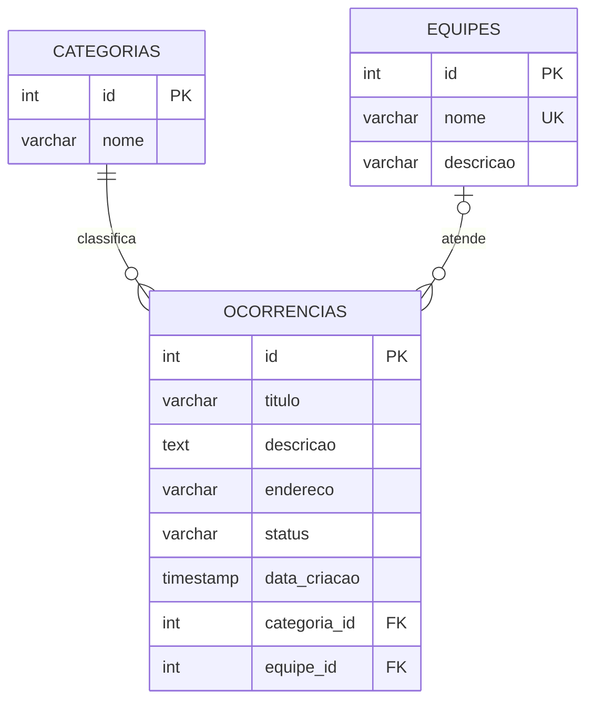

# Modelo de domínio

## Entidades

| Entidade | O que representa | Como se relaciona |
| --- | --- | --- |
| Ocorrência | Um problema urbano registrado no sistema | Pertence a **uma** categoria (obrigatório) e pode ter **uma** equipe responsável (opcional) |
| Categoria | O tipo de problema urbano (iluminação, trânsito, coleta de lixo) | Classifica **várias** ocorrências |
| Equipe responsável | O grupo encarregado de atender ocorrências | Pode ser responsável por **várias** ocorrências |

## Diagrama das tabelas



## Atributos

### categorias

| Coluna | Tipo | Regras |
| --- | --- | --- |
| id | SERIAL | Chave primária |
| nome | VARCHAR | Obrigatório. A unicidade é verificada pelo `CategoriaService`, não por restrição no banco |

### equipes

| Coluna | Tipo | Regras |
| --- | --- | --- |
| id | SERIAL | Chave primária |
| nome | VARCHAR(100) | Obrigatório e único (`uq_equipes_nome`) |
| descricao | VARCHAR(255) | Opcional |

### ocorrencias

| Coluna | Tipo | Regras |
| --- | --- | --- |
| id | SERIAL | Chave primária |
| titulo | VARCHAR(150) | Obrigatório |
| descricao | TEXT | Obrigatório |
| endereco | VARCHAR(255) | Obrigatório |
| status | VARCHAR(20) | Obrigatório, padrão `ABERTA`. `CHECK` aceita só `ABERTA`, `EM_ATENDIMENTO` e `CONCLUIDA` |
| data_criacao | TIMESTAMP | Obrigatório, padrão `NOW()` |
| categoria_id | INTEGER | Obrigatório. Chave estrangeira para `categorias(id)` |
| equipe_id | INTEGER | Opcional (`NULL`). Chave estrangeira para `equipes(id)` |

## Ciclo de vida da ocorrência

    ```
ABERTA  →  EM_ATENDIMENTO  →  CONCLUIDA
```

Não se pula etapa e não se volta atrás. `CONCLUIDA` é estado final.
    A regra de transição está em `src/model/StatusOcorrencia.js`.

## Garantia da regra R4 no banco

A migration V3 cria um índice único parcial:

    ```sql
CREATE UNIQUE INDEX ux_ocorrencias_aberta_endereco_categoria
  ON ocorrencias (categoria_id, LOWER(TRIM(endereco)))
  WHERE status = 'ABERTA'
```

Ele vale só para ocorrências `ABERTA`, ignora maiúsculas e espaços nas pontas.
    Por isso, depois de concluída, uma ocorrência não impede que outra seja aberta
no mesmo endereço e categoria.

## Migrations

| Ordem | Arquivo | O que faz |
| --- | --- | --- |
| V1 | `V1__criar_categorias.js` | Cria `categorias` |
| V2 | `V2__criar_equipes.js` | Cria `equipes` |
| V3 | `V3__criar_ocorrencias.js` | Cria `ocorrencias`, com chaves estrangeiras, `CHECK` e índice único parcial |

A ordem importa: a V3 referencia as tabelas das duas anteriores.

## Observação sobre `equipe_id`

A coluna `equipe_id` existe no banco, mas nesta etapa o model `Ocorrencia` não a
mapeia e nenhuma rota atribui equipe. Nenhuma regra de negócio depende de equipe.
    A atribuição de equipe a uma ocorrência é evolução futura.
